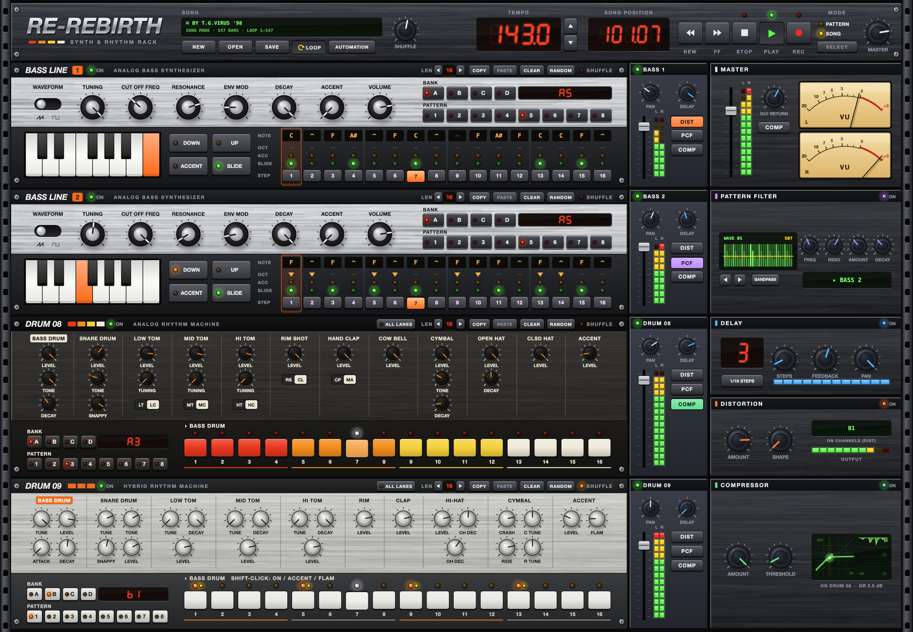

# Re-Rebirth

A tribute to [ReBirth RB-338](https://en.wikipedia.org/wiki/ReBirth_RB-338) in the browser: two acid bass lines, two drum machines, a mixer with effects and VU meters, and a pattern/song sequencer. It opens original ReBirth 2.0 songs (`.rbs`) and plays them back, and it's built for making new ones: focused stages for writing, arranging, automating and mixing, MIDI controllers, and WAV export.

Everything is drawn on a canvas and every sound is synthesized live with the Web Audio API: no samples.



**Try it:** [rb.varyform.info](https://rb.varyform.info). Click the logo and choose **Load TGV's KiloMix '98** for an example song, then press <kbd>Space</kbd>. Press <kbd>2</kbd> to start writing patterns, and <kbd>/</kbd> any time for the keys that work where you are.

## Making music

The rack shows everything at once, the way ReBirth did. For working on a song there are four **stages**, each showing only what it needs, as large as the window allows: PATTERNS, ARRANGE, AUTOMATE and MIX (keys <kbd>2</kbd>–<kbd>5</kbd>; <kbd>1</kbd> is the rack). They share a slim transport bar and a **rail** down the left with a strip per machine: its ON light, live meters (ghosted grey while it's muted, so you can see it running along), its volume, and the pattern it's playing. Click a strip to bring that machine up.

The stages fit any window shape, wide or tall: controls and type grow into the room, while lines stay one pixel thin.

### PATTERNS: write the parts


One instrument fills the window. Type bass lines on the computer keyboard (<kbd>A</kbd> <kbd>W</kbd> <kbd>S</kbd> … <kbd>K</kbd> are C to C, the cursor moves on by itself) or play them on a MIDI keyboard. Drum machines show every lane at once, and play from the home row or MIDI pads. PATTERNS always loops the patterns you pick, so what you choose stays.

| Drum 09, all lanes | The pattern picker |
|---|---|
|  |  |

Click a machine's pattern on the rail (or press <kbd>P</kbd>) for the **pattern picker**: all 32 of its patterns at once, bass lines as little piano rolls and drum patterns as lane grids. Click one, or step with the arrow keys, to hear combinations: A1 on one bass line against A4 on the other.

### ARRANGE: build the song


A row per machine, bars across. Paint bars with a row's brush pattern, switch a machine off for some bars on the thin lane under its row, and mark bars A–B on the ruler to duplicate, delete or insert them; knob automation moves along. Everything can be undone.

### AUTOMATE: ride the knobs


Set an A–B loop on the song timeline, arm REC and play: the loop goes round, and every knob you touch is recorded, several at once from a MIDI controller. LATCH holds your last value to the end of the pass, TOUCH lets go when you do; either way the old automation carries on after. Each pass is a take, and UNDO PASS takes back the ones you don't like. ReBirth never had this.

### MIX: balance and finish


The four channel strips with long faders and SOLO, the effects and the master with its VU needles, all large. Controls the song automates carry an orange dot. **EXPORT** on the bar renders the song, the A–B loop or the patterns to a WAV with the same engine, faster than real time (on iPad, through the share sheet).

### MIDI controllers


Plug in a MIDI controller (Chrome, Edge or Firefox) and click **MIDI** on the bar. **SET UP MY CONTROLLER** asks for each control in turn, with a picture lighting the one to touch; half a minute later every knob, slider, pad and button does its job, whatever numbers it sends. The knobs follow the instrument on screen (cutoff, resonance, env mod, decay… on a bass line, the selected drum's knobs on a drum machine), sliders are the volumes, the big knob steps patterns, and green badges on screen show which hardware control drives what. MIDI LEARN binds anything else. Laid out for an Arturia MiniLab 3, but any controller works.

### Keyboard


Everything has a key, and <kbd>/</kbd> lists the ones that work where you are, in type you can read from across the desk.

## Features

- **Bass Line 1 & 2:** monophonic acid synths with saw/square waveform, tuning, cutoff, resonance, envelope mod, decay and accent. Per-step notes, octave, accent and slide.
- **Drum 08:** analog-style rhythm machine. The LT/LC, MT/MC, HT/HC, RS/CL and CP/MA switches select congas, claves and maracas.
- **Drum 09:** hybrid rhythm machine with per-step accent and flam.
- **ALL LANES grid** on both drum machines: see and paint every instrument of a pattern at once.
- **Channel strips** beside each instrument: on switch, pan, delay send, level fader with left/right meters, and distortion / pattern filter / compressor routing.
- **Master:** fader with left/right meters, delay return, compressor on the master, and analogue VU needles; click them for a spectrum display.
- **Effects:** tempo-synced delay, distortion, compressor and a pattern-controlled filter.
- **Sequencer:** 32 patterns per device (banks A–D), length and shuffle per pattern, copy/paste/clear/random.
- **Song mode:** play a song's arrangement and automation, loop a range, or arm REC and record pattern changes and knob moves.
- **Automation window:** every recorded control of the song as a graph over time. Pan, zoom, and click the ruler to jump.
- **Songs:** opens ReBirth 2.0 / 2.0.1 `.rbs` files and saves its own `.json`, or a `.rbs` that ReBirth itself can open (⌘/Ctrl ⇧ S). Work is autosaved in the browser.
- **Song library:** drop folders of songs; search, sort, rate and share them.
- **Stages, MIDI, WAV export:** see [Making music](#making-music).
- The rack scales to fill the window. It works with a mouse, a trackpad or touch, including iPad and iPhone.

### Keys and gestures

| | |
|---|---|
| <kbd>Space</kbd> | Play / stop (stop twice to rewind) |
| Drop a `.rbs` / `.json` file | Open it |
| Drag a knob up/down, or scroll | Turn it; hold <kbd>Shift</kbd> for fine steps, double-click to reset |
| Hold REW / FF | Seek, faster the longer you hold |
| Click or drag the SONG display (song mode) | Jump to that point in the song |
| Shift-click a Drum 09 step | Cycle on → accent → flam → off |
| <kbd>/</kbd> | **Every shortcut that works where you are** (the full list) |
| <kbd>1</kbd>–<kbd>5</kbd> | RACK, PATTERNS, ARRANGE, AUTOMATE, MIX |
| <kbd>↑</kbd> <kbd>↓</kbd> | Previous / next instrument (focus stages) |
| <kbd>[</kbd> <kbd>]</kbd>, <kbd>P</kbd> | Previous / next pattern, pattern picker |
| <kbd>←</kbd> <kbd>→</kbd> | Back / forward a bar; in PATTERNS the step cursor or drum lane |
| <kbd>M</kbd>, <kbd>Shift</kbd> <kbd>M</kbd> | Instrument on/off, solo |
| <kbd>R</kbd>, <kbd>Home</kbd>, <kbd>⌘/Ctrl</kbd> <kbd>Z</kbd> | Record, to the start, undo a pass or edit |
| <kbd>⌘/Ctrl</kbd> <kbd>S</kbd> / <kbd>O</kbd> / <kbd>E</kbd> | Save, open, export WAV |
| <kbd>⌘/Ctrl</kbd> <kbd>⇧</kbd> <kbd>S</kbd>, or Shift-click SAVE | Save as a ReBirth song (`.rbs`) |
| <kbd>Esc</kbd> | Close a window |
| <kbd>F</kbd> | Full screen on/off (outside PATTERNS) |
| PATTERNS, bass shown: <kbd>A</kbd> <kbd>W</kbd> <kbd>S</kbd> … <kbd>K</kbd> | Write a note (C to C) on the selected step and move on; <kbd>Shift</kbd> adds accent |
| PATTERNS, bass shown: <kbd>Z</kbd> / <kbd>X</kbd>, <kbd>Tab</kbd>, <kbd>⌫</kbd> | Octave down/up, slide into the next note, rest |
| PATTERNS, drums shown: <kbd>A</kbd> <kbd>S</kbd> <kbd>D</kbd> … <kbd>'</kbd> | Play a lane and select it; <kbd>Shift</kbd> accents |

## Song compatibility

Re-Rebirth reads songs made with ReBirth 2.0 and 2.0.1 that use the standard sounds. Songs made for a ReBirth *mod* (custom samples and graphics) are refused, since their sounds can't be reproduced. Many songs are in the [nordbeat ReBirth archive](https://nordbeat.com/archive/rebirth/song_archives.htm).

The file reader follows Propellerhead's format description ([`docs/RBS42.txt`](docs/RBS42.txt)). Where real files disagree with the description, the files win; those places are noted in [`src/song/rbs.js`](src/song/rbs.js).

## How close does it sound?

The voices and effects are synthesized from scratch. Their settings were fitted by measuring ReBirth's own renders: full songs, per-channel exports and a test song that plays every drum sound in isolation. Only levels, pitch, decay and spectra were measured; no audio from ReBirth is included or used in the app. A few rules (the level curve and pan law, the tune knob's steps, how bass rests and slides play, and the Vintage sound) follow the documentation of ReBirth's engine by [OpenRB-338](https://github.com/pingw33n/openrb-338).

## Development

Tool versions are pinned with [mise](https://mise.jdx.dev) in `mise.toml`: Node for the app, Python for the calibration scripts and Ruby for Kamal. Run `mise install` once.

```sh
npm install
npm run dev      # local dev server
npm run build    # static site in dist/
```

The app is plain JavaScript with no framework, built with Vite:

| Path | |
|---|---|
| `src/audio/` | Web Audio engine: bass voice, drum voices, effects, mixer |
| `src/render/` | Canvas views: the rack, the focus stages, devices, controls, windows |
| `src/sequencer/` | Lookahead clock and pattern scheduling |
| `src/song/` | Song model, playback/recording, `.rbs` reader and writer, `.json` sessions |
| `src/ui/` | Pointer handling, hit regions, keyboard shortcuts |
| `src/midi.js` | Web MIDI: controller layouts, setup walkthrough, learn |
| `tools/` | Offline rendering and analysis scripts used for calibration; `icons.mjs` renders the home-screen PNGs from `public/icon.svg`; `screenshot.mjs` takes this README's top screenshot and `screenshots.mjs` the stage ones in `docs/screenshots/`; `video.mjs` makes a 1080p video of a song playing, views switching |

### Song videos

`tools/video.mjs` makes an MP4 of a song playing in the app, cycling through the rack and the stages: the sound rendered offline with the real engine, the picture recorded from the app playing live in headless Chrome, aligned on bar 1. It runs in real time and needs ffmpeg:

```sh
node tools/video.mjs "song.rbs" [out.mp4] [--seconds 40] [--size 1920x1080] [--keep]
```

### Calibration tools

`npm run render` renders a song offline with the real engine in headless Chrome. It uses the locally installed Chrome; set `CHROME=/path/to/chrome` to override.

```sh
npm run render -- "tracks/song.rbs" out.wav --start 1 --bars 16 --rate 44100 [--solo r909] [--set fx.dist.on=0] [--no-trim]
```

The Python scripts in `tools/` compare such renders against reference recordings per bar, step, band and isolated hit. They need [uv](https://docs.astral.sh/uv/):

```sh
uv run --with numpy --with scipy python tools/steps.py score reference.wav --bpm 143 --ref-bar1 0.004 out.wav:1:1:8
```

## Deployment

The site is static: a Vite build served by nginx (`Dockerfile`, `config/nginx.conf`). It's deployed with [Kamal](https://kamal-deploy.org) (`config/deploy.yml`), which ships the image through Kamal's local registry over SSH; kamal-proxy on the server gets a Let's Encrypt certificate.

The server and hostname live in `.env.deploy` (gitignored). Copy the example and fill it in; variables already set in the shell win:

```sh
cp .env.deploy.example .env.deploy   # SITE_SERVER (IP or hostname), SITE_HOST
kamal setup                          # once per server: installs Docker and kamal-proxy
kamal deploy
```

`SITE_HOST` needs an A record pointing at `SITE_SERVER`, with ports 80 and 443 open for the certificate.

## License

The code is [MIT](LICENSE). Two files in the repository aren't mine and keep their own terms: the format description [`docs/RBS42.txt`](docs/RBS42.txt) (Propellerhead Software) and the example song [`public/songs/tgv-kilomix-98.rbs`](public/songs/tgv-kilomix-98.rbs) (T.G.ViRUS).

## Credits

- Made by Oleh Khomei, 2026. See [`CHANGELOG.md`](CHANGELOG.md) for what changed between versions.
- A tribute to ReBirth RB-338 by Propellerhead Software (1997). This is an independent project, not affiliated with or endorsed by Reason Studios. ReBirth is a trademark of its owner.
- The RBS format description is © 1998 Propellerhead Software AB and is included unmodified, as its terms require.
- Example song: *TGV's KiloMix '98* by T.G.ViRUS, written for ReBirth 2.0.
